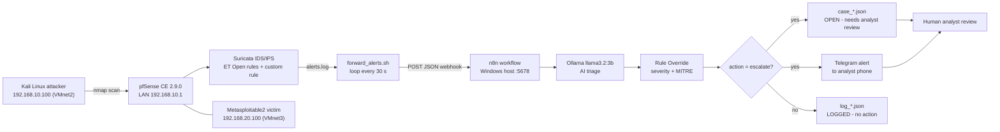
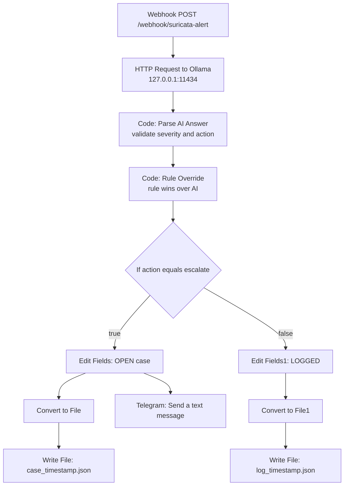

# SOC Home Lab with AI Alert Triage (Suricata + pfSense + n8n + Ollama + Telegram)

A fully isolated home lab where an attacker VM scans a victim VM, **Suricata IDS/IPS** on pfSense raises alerts, and an **n8n workflow with a local LLM (Ollama, llama3.2:3b)** triages each alert automatically and sends a case notification to **Telegram**.

> **Human review always stays.** AI output never triggers a response action on its own. A deterministic rule override decides severity and MITRE mapping, and every escalated case is created as `OPEN - needs analyst review`.

> **Lab use only.** All scanning is done inside an isolated virtual network. Never scan real networks.

---

## 1. Goal

When Suricata raises an alert, the system automatically produces a case containing:

| Question | Field |
|---|---|
| What happened | `reason` |
| Where | `src -> dst : dport` |
| Why it matters | `mitre_id` (MITRE ATT&CK technique) |
| How bad | `severity` (low / medium / high) |
| What next | `action` (log or escalate) |

## 2. Architecture



### n8n workflow ("Suricata Triage-Alert")



## 3. Environment

| Item | Detail |
|---|---|
| Host | Windows laptop, i5-1235U, 8 GB RAM, no GPU |
| Hypervisor | VMware Workstation Pro |
| Firewall / IDS | pfSense CE 2.9.0 (2 GB RAM) with Suricata package |
| Attacker | Kali Linux, VMnet2, 192.168.10.100 |
| Victim | Metasploitable2, VMnet3, 192.168.20.100 |
| Network | WAN em0 VMnet8 NAT, LAN em1 192.168.10.1/24 (VMnet2), OPT1 em2 192.168.20.1/24 (VMnet3) |
| Automation | n8n 2.35.7 (run with npx), UI at http://localhost:5678 |
| AI | Ollama with `llama3.2:3b` (CPU only) |
| Notification | Telegram bot (BotFather) |

## 4. Suricata configuration

- Interface: LAN only. Rules: **ET Open**.
- IPS mode: Legacy Mode, **Block Offenders**, block SRC, Kill States, pass list `LabPass`.
- Custom rule `sid 1000001` "LAB Possible SYN port scan".
- Alert log: `/var/log/suricata/suricata_em153236/alerts.log`

Example alert line:

```
10/25/2026-15:02:57.435925 [**] [1:2024364:5] ET SCAN Possible Nmap User-Agent Observed [**] [Classification: Web Application Attack] [Priority: 1] {TCP} 192.168.10.100:53310 -> 192.168.20.100:80
```

Unblock the attacker after Suricata blocks it:

```sh
pfctl -t snort2c -T flush
```

## 5. Rule override (MITRE ATT&CK mapping)

A 3B model is weak at classification, so a deterministic rule layer decides severity and technique. Rule wins over AI (`source = "rule"`).

| Signature prefix | MITRE | Severity |
|---|---|---|
| LAB Possible SYN port scan | T1046 | medium |
| ET SCAN | T1595 | medium |
| ET WEB_SERVER / WEB_SPECIFIC_APPS / SQL | T1190 | high |
| ET EXPLOIT / FTP / ATTACK_RESPONSE | T1210 | high |
| ET MALWARE / TROJAN / CNC | T1071 | high |
| ET DOS | T1498 | medium |
| ET PHISHING | T1566 | medium |

Force `escalate` if priority is 1 or signature starts with `ET EXPLOIT`, `ET WEB`, `ET MALWARE`. If the AI answer fails validation, the workflow forces `unknown + escalate` (fail safe).

## 6. Sample case output

```json
[{"signature":"ET SCAN Possible Nmap User-Agent Observed","src":"192.168.10.100","dst":"192.168.20.100","dport":8180,"priority":1,"severity":"medium","mitre_id":"T1595","action":"escalate","source":"rule","reason":"Nmap User-Agent observed, potential reconnaissance tool","case_status":"OPEN - needs analyst review","received_at":"2026-10-28T02:02:34.663-04:00"}]
```

Telegram message template (n8n expression):

```
🚨 SOC ALERT ({{ $json.severity }})
Reason: {{ $json.reason }}
Where: {{ $json.src }} -> {{ $json.dst }}:{{ $json.dport }}
Signature: {{ $json.signature }}
MITRE: {{ $json.mitre_id }}
Action: {{ $json.action }}
Status: {{ $json.case_status }}
```

## 7. Commands used

### 7.1 Kali (lab only)

| Command | Purpose |
|---|---|
| `ip a` | Show Kali IP address |
| `nmap -sV 192.168.10.1` | Port scan + service version detection against pfSense (triggers ET SCAN) |
| `nmap -sV 192.168.20.100` | Same against Metasploitable2 (alerts on ports 80 and 8180) |

### 7.2 pfSense shell (console menu option 8)

The VMware console does not support paste, so commands are typed by hand. pfSense shell is tcsh-like: use `>&`, not `2>&1`.

| Command | Purpose |
|---|---|
| `pfctl -t snort2c -T flush` | Clear Suricata block table (unblock Kali) |
| `cat /root/alerts.offset` | Last alert line already forwarded |
| `wc -l /var/log/suricata/suricata_em153236/alerts.log` | Total lines in alerts.log (`-l` lowercase L) |
| `ps ax \| grep forward` | Check forward loop is running |
| `tail -5 /root/forward.log` | Last 5 forwarder outputs ("Sent: ...") |
| `/root/forward_alerts.sh` | Push pending alerts to n8n manually |
| `chmod +x /root/forward_alerts.sh` | Make script executable |

Start the forward loop (must be retyped after every pfSense reboot):

```sh
nohup sh -c 'while true; do /root/forward_alerts.sh; sleep 30; done' >& /root/forward.log &
```

`nohup` keeps it running, `>&` sends output to the log, trailing `&` runs it in the background.

### 7.3 Windows PowerShell (n8n, Ollama, checks)

Start n8n (needed every time, otherwise file write fails with "Access to the file is not allowed"):

```powershell
$env:N8N_RESTRICT_FILE_ACCESS_TO="C:\Users\home\.n8n-files"
$env:N8N_BLOCK_FILE_ACCESS_TO_N8N_FILES="false"
npx n8n
```

| Command | Purpose |
|---|---|
| `ollama list` | Confirm `llama3.2:3b` is installed |
| `Invoke-RestMethod -Uri http://localhost:5678/webhook/suricata-alert -Method Post -ContentType "application/json" -Body '{"signature":"ET SCAN Possible Nmap User-Agent Observed","src":"192.168.10.100","dst":"192.168.10.1","dport":80,"priority":1}'` | Send a fake alert to test the workflow |
| `Get-ChildItem C:\Users\home\.n8n-files \| Sort-Object LastWriteTime -Descending \| Select-Object -First 8 Name, LastWriteTime` | Newest case/log files |
| `$f = Get-ChildItem C:\Users\home\.n8n-files\case_*.json \| Sort-Object LastWriteTime -Descending \| Select-Object -First 1; $f.Name; Get-Content $f.FullName -Raw` | Read newest case file |
| `Invoke-RestMethod "https://api.telegram.org/bot<TOKEN>/getUpdates"` | Find Telegram chat ID (never publish the token) |

## 8. Setup summary

1. Build VMs and networks (VMnet2, VMnet3, VMnet8) in VMware.
2. Install pfSense, then the Suricata package. Enable ET Open rules on LAN, IPS mode, pass list `LabPass`.
3. Add the custom SYN scan rule (sid 1000001).
4. Install Ollama and pull the model: `ollama pull llama3.2:3b`.
5. Run n8n, import `workflow/suricata-triage-alert.json`, publish it.
6. Allow inbound TCP 5678 from 192.168.83.0/24 in Windows Firewall (rule "n8n lab webhook") so pfSense can reach the webhook.
7. Copy `forward_alerts.sh` to pfSense (transfer via a temporary http-server, remove CRLF, `chmod +x`), start the loop.
8. Create a Telegram bot with @BotFather, add credential in n8n, add the Telegram node on the escalate branch.

## 9. Startup and shutdown order

**Startup:** pfSense, then n8n (3 commands), then Ollama (`ollama list`), then the forward loop in the pfSense shell, then Kali/Metasploitable only when testing.

**Shutdown:** shut down Kali and Metasploitable guests, Ctrl+C in n8n window, quit Ollama, pfSense console option 6 (Halt).

## 10. Lessons learned

- **RAM is the limit (8 GB).** With all VMs plus Ollama running, the n8n HTTP node timed out at 2 minutes and no case was written. Generate alerts with Kali and Metasploitable on, shut them down, then let triage run. Timeout raised to 300000 ms.
- **Windows Firewall block rules** for `node.exe` were the real reason pfSense `curl` returned 000.
- **Time zones differ:** pfSense logs UTC, laptop IST, Kali -04:00. IST normalisation is a planned improvement.
- **Weak LLM, so rules decide.** Deterministic override plus fail-safe escalate is more trustworthy than raw model output.
- **The forward loop dies on pfSense reboot.** Auto-start is still a to-do.
- **Typing by hand causes typos** (`noshup`, `wc -1`). Keep commands short and verify the screen.
- **Telegram:** the first message must be sent to your own bot (not BotFather) before `getUpdates` shows a chat ID.

## 11. Roadmap

- [ ] Auto-start forward loop (shellcmd package or rc script)
- [ ] IST timestamps in case records
- [ ] Practice attacks: SQLi, vsftpd 2.3.4 with Metasploit, msfvenom reverse shell, DoS
- [ ] garak vulnerability scan: Llama vs a Dolphin model
- [ ] Tines story (check free tier)
- [ ] Case dashboard

## 12. Security notes

- Never commit tokens, chat IDs, passwords or credential files. Rotate the Telegram token with `/revoke` in BotFather if it leaks.
- The lab network is isolated. Do not scan systems you do not own.
- AI triage supports the analyst; it does not replace analyst judgement.

## 13. Repository layout

```
soc-ai-triage-lab/
├── README.md
├── .gitignore
├── workflow/suricata-triage-alert.json
├── scripts/forward_alerts.sh
├── docs/architecture.md
└── screenshots/
```

Author: Prabhas Kotakonda, Hyderabad. Tags: SOC, Blue Team, Suricata, pfSense, n8n, Ollama, MITRE ATT&CK, SOAR.
